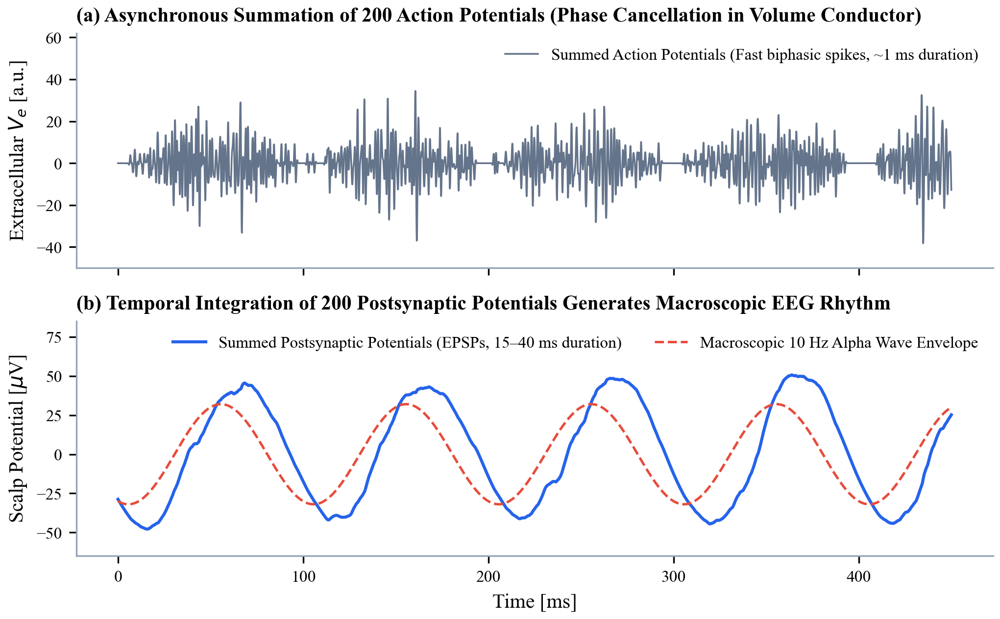
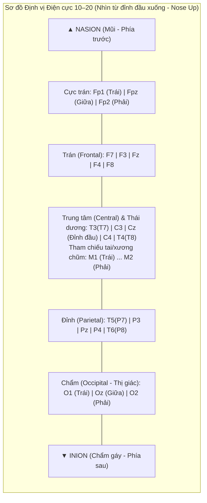
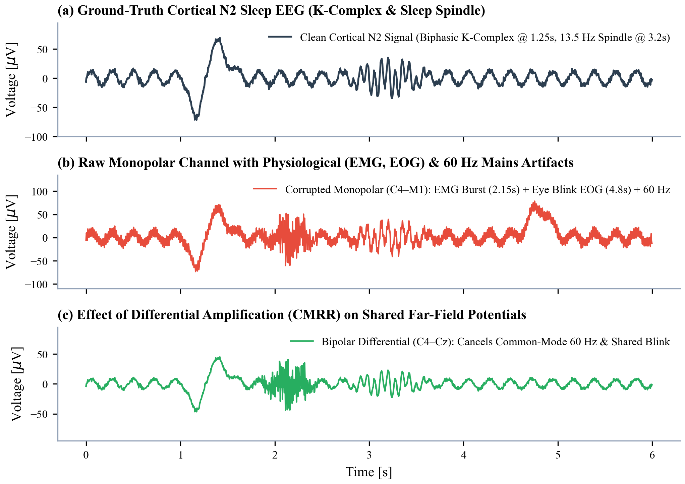
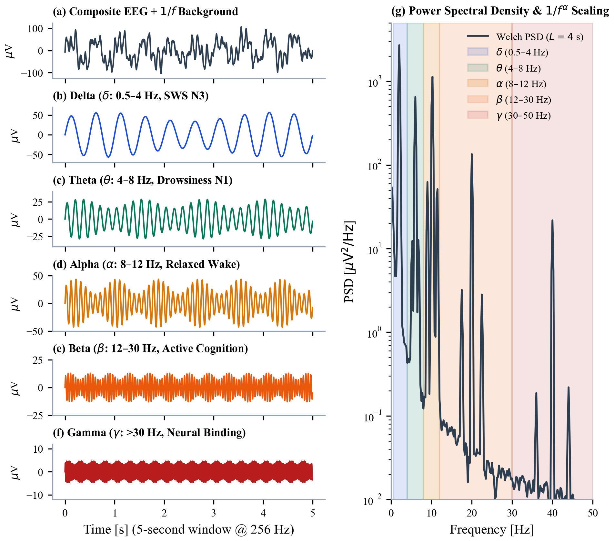

# Cẩm Nang Nền Tảng Điện Não Đồ (EEG): Sinh Lý Thần Kinh, Cơ Chế Vật Lý & Hệ Thống Thu Nhận
*(Phase 1 – Lesson 1: EEG Fundamentals, Neurophysiology, Acquisition Systems & Canonical Rhythms)*

Tài liệu này tổng hợp toàn diện toàn bộ kiến thức nền tảng của **Bài 1 (Phase 1)** trong chương trình nghiên cứu chuyên sâu về EEG, bao gồm: cơ chế sinh lý thần kinh ở cấp độ tế bào, mô hình toán học - vật lý của trường điện thế ngoại bào, hệ thống đặt điện cực quốc tế 10–20, nguyên lý khuếch đại vi sai (Montages & CMRR), phân tích 5 dải tần số chuẩn ($\delta, \theta, \alpha, \beta, \gamma$), các nguồn nhiễu (Artifacts) và ánh xạ trực tiếp vào bộ dữ liệu **MESA Sleep**.

---

## Mục lục
1. [Tổng quan về Điện não đồ (Introduction to EEG)](#1-tổng-quan-về-điện-não-đồ-introduction-to-eeg)
2. [Cấu trúc Tế bào Thần kinh & Các Điện thế Màng (AP vs. EPSP/IPSP)](#2-cấu-trúc-tế-bào-thần-kinh--các-điện-thế-màng-ap-vs-epspipsp)
3. [Cơ chế Hình thành Tín hiệu EEG & Mô hình Toán học (EEG Signal Generation)](#3-cơ-chế-hình-thành-tín-hiệu-eeg--mô-hình-toán-học-eeg-signal-generation)
4. [Hệ thống Điện cực Quốc tế 10–20 (International 10–20 System)](#4-hệ-thống-điện-cực-quốc-tế-1020-international-1020-system)
5. [Đạo trình Đo (Monopolar vs. Bipolar Montage), Reference, Ground & CMRR](#5-đạo-trình-đo-monopolar-vs-bipolar-montage-reference-ground--cmrr)
6. [Đặc tính Biên độ, Tần số, Tốc độ lấy mẫu & Quy luật Phổ $1/f^\alpha$](#6-đặc-tính-biên-độ-tần-số-tốc-độ-lấy-mẫu--quy-luật-phổ-1falpha)
7. [Phân tích Chuyên sâu 5 Dải Tần số EEG Chuẩn ($\delta, \theta, \alpha, \beta, \gamma$)](#7-phân-tích-chuyên-sâu-5-dải-tần-số-eeg-chuẩn-delta-theta-alpha-beta-gamma)
8. [Các Nguồn Nhiễu Điển hình trong EEG (EEG Artifacts)](#8-các-nguồn-nhiễu-điển-hình-trong-eeg-eeg-artifacts)
9. [Ánh xạ Thực tế vào Bộ dữ liệu MESA Sleep & Định hướng Edge AI](#9-ánh-xạ-thực-tế-vào-bộ-dữ-liệu-mesa-sleep--định-hướng-edge-ai)
10. [Mã nguồn Python Mô phỏng & Bài tập Nghiên cứu](#10-mã-nguồn-python-mô-phỏng--bài-tập-nghiên-cứu)

---

## 1. Tổng quan về Điện não đồ (Introduction to EEG)

**Điện não đồ (Electroencephalography – EEG)** là phương pháp đo lường và ghi lại sự biến thiên của trường điện thế sinh học trên bề mặt da đầu (Scalp EEG) do hoạt động điện tổng hợp của hàng triệu tế bào thần kinh trong vỏ não tạo ra.

### So sánh EEG với các tín hiệu y sinh khác (ECG, PPG)

| Tiêu chí | Điện não đồ (Scalp EEG) | Điện tâm đồ (ECG) | Quang thể tích đồ (PPG) |
| :--- | :--- | :--- | :--- |
| **Nguồn phát sinh lý** | Tổng hợp điện thế hậu synap của hàng chục triệu tế bào tháp vỏ não. | Sự khử cực và tái cực đồng bộ của khối cơ tim (nút xoang điều nhịp). | Sự thay đổi thể tích máu vi mạch ngoại vi theo chu kỳ bơm của tim. |
| **Biên độ điển hình** | **Rất nhỏ: $10\text{–}100\text{ }\mu\text{V}$** | Lớn: $0.5\text{–}3.0\text{ mV}$ (lớn gấp $\sim 100$ lần EEG) | Phụ thuộc cường độ LED & khuếch đại quang (thường chuẩn hóa AC/DC). |
| **Băng thông hữu ích** | **$0.5\text{–}100\text{ Hz}$** (Lâm sàng giấc ngủ AASM: **$0.3\text{–}35\text{ Hz}$**) | $0.05\text{–}100\text{ Hz}$ (Năng lượng QRS tập trung ở $5\text{–}25\text{ Hz}$) | $0.5\text{–}10\text{ Hz}$ (Tần số nhịp tim cơ bản $0.8\text{–}3.5\text{ Hz}$) |
| **Tính chất thống kê** | **Phi dừng mạnh (Highly non-stationary)**, phi tuyến, dạng sóng ngẫu nhiên chồng lấn đa tần số. | Tuần hoàn giả dừng (Quasi-periodic) với hình thái P-QRS-T lặp lại rõ ràng. | Tuần hoàn trơn (Smooth quasi-periodic) gồm đỉnh tâm thu và khuyết dicrotic. |
| **Tỷ số Tín hiệu / Nhiễu (SNR)** | **Rất thấp** (bị suy hao mạnh qua hộp sọ và dễ lẫn nhiễu mắt, cơ, điện lưới). | Trung bình – Cao. | Trung bình (rất nhạy với nhiễu chuyển động – Motion artifacts). |

---

## 2. Cấu trúc Tế bào Thần kinh & Các Điện thế Màng (AP vs. EPSP/IPSP)

### 2.1. Giải phẫu chức năng của một Neuron
Một tế bào thần kinh điển hình trong vỏ não gồm 3 phần chính đóng vai trò như một mạch xử lý tín hiệu:
1. **Đuôi gai (Dendrites – Đầu vào / Input):** Nhận tín hiệu từ hàng ngàn tế bào thần kinh khác thông qua các khớp thần kinh (**Synapses**).
2. **Thân tế bào (Soma – Bộ tích hợp / Integrator):** Tích hợp các dòng điện truyền về từ đuôi gai.
3. **Sợi trục (Axon – Đầu ra / Output):** Khởi phát xung điện tại gò sợi trục (*Axon hillock*) và truyền đi xa tới các neuron tiếp theo.

### 2.2. Hai loại Điện thế Thần kinh: Tại sao EEG đo PSP chứ KHÔNG đo trực tiếp Action Potential?

Khi ở trạng thái nghỉ, màng tế bào thần kinh duy trì điện thế phân cực âm bên trong so với bên ngoài (**Resting Membrane Potential $\approx -70\text{ mV}$**) nhờ bơm $\text{Na}^+/\text{K}^+\text{-ATPase}$. Khi hoạt động, có hai loại biến thiên điện thế xảy ra:

#### A. Điện thế Hoạt động (Action Potential – AP / "Spikes")
* **Cơ chế:** Khi điện thế tại gò sợi trục vượt ngưỡng ($\approx -55\text{ mV}$), kênh $\text{Na}^+$ phụ thuộc điện thế mở ồ ạt làm điện thế vọt lên $+30\text{ mV}$ (khử cực), ngay lập tức đóng lại và kênh $\text{K}^+$ mở ra kéo điện thế về mức nghỉ (tái cực).
* **Đặc tính:** Biên độ nội bào rất lớn ($\sim 100\text{ mV}$), nhưng **thời gian diễn ra cực ngắn ($\sim 1\text{–}2\text{ ms}$)** và tạo ra trường điện thế dạng **Tứ cực (Quadrupole)** suy giảm theo lũy thừa bậc ba của khoảng cách ($1/R^3$).
* **Tại sao không tạo ra EEG bề mặt?** Vì xung kéo dài chỉ $1\text{ ms}$ và có cả pha âm lẫn pha dương đối xứng, nếu hai neuron phát xung lệch nhau chỉ $0.5\text{ ms}$, pha dương của neuron này sẽ **triệt tiêu (Phase Cancellation)** pha âm của neuron kia.

#### B. Điện thế Hậu Synap (Postsynaptic Potentials – PSP: EPSP & IPSP)
Khi chất dẫn truyền thần kinh (Neurotransmitter) gắn vào thụ thể ở màng sau synap trên đuôi gai hoặc thân tế bào, nó mở các kênh ion cục bộ:
1. **EPSP (Excitatory Postsynaptic Potential – Điện thế hậu synap kích thích):**
   - Do chất dẫn truyền kích thích (chủ yếu là **Glutamate** qua thụ thể AMPA/NMDA) mở kênh cho dòng ion dương ($\text{Na}^+, \text{Ca}^{2+}$) chảy từ khoảng ngoại bào **đi vào trong** tế bào.
   - Tại vị trí synap ngoài màng tế bào bị mất bớt ion dương $\rightarrow$ trở thành một **Điểm hút dòng (Current Sink – mang điện thế ngoại bào Âm)**.
   - Dòng điện chảy dọc bên trong đuôi gai về phía thân tế bào rồi thoát ra ngoài qua màng thụ động $\rightarrow$ vị trí thoát ra trở thành **Điểm nguồn dòng (Current Source – mang điện thế ngoại bào Dương)**.
2. **IPSP (Inhibitory Postsynaptic Potential – Điện thế hậu synap ức chế):**
   - Do chất dẫn truyền ức chế (chủ yếu là **GABA** qua thụ thể $\text{GABA}_\text{A}/\text{GABA}_\text{B}$) mở kênh cho $\text{Cl}^-$ đi vào hoặc $\text{K}^+$ đi ra khỏi tế bào.
   - Tạo ra một **Điểm nguồn dòng (Current Source – mang điện thế ngoại bào Dương)** ngay tại vị trí synap, và **Điểm hút dòng (Current Sink – Âm)** ở phần còn lại của tế bào.

* **Đặc tính quyết định của EPSP/IPSP:**
  - Biên độ nội bào nhỏ ($\sim 1\text{–}10\text{ mV}$), nhưng **thời gian kéo dài rất lâu ($15\text{–}100\text{ ms}$, thậm chí $>200\text{ ms}$)**.
  - Tạo ra trường điện thế dạng **Lưỡng cực (Dipole)** suy giảm chậm hơn theo khoảng cách ($1/R^2$).
  - Nhờ kéo dài hàng chục mili-giây, các EPSP/IPSP từ hàng triệu synap dễ dàng **chồng lấp và cộng hưởng theo thời gian (Temporal Summation)** để tạo thành sóng não vĩ mô!



---

## 3. Cơ chế Hình thành Tín hiệu EEG & Mô hình Toán học (EEG Signal Generation)

### 3.1. Hình học Mở (Open-Field Geometry) của Tế bào Tháp Vỏ não
Để điện thế của hàng triệu tế bào không tự triệt tiêu nhau trong không gian, chúng phải được sắp xếp song song và cùng chiều. Trong vỏ não người, **Tế bào Tháp (Pyramidal Neurons)** ở lớp III và lớp V đáp ứng hoàn hảo điều kiện này:
- Thân tế bào (Soma) nằm ở lớp sâu, còn **Đuôi gai đỉnh (Apical Dendrite)** vươn dài vuông góc hướng thẳng lên bề mặt vỏ não.
- Khi hàng chục ngàn tế bào tháp liền kề cùng nhận tín hiệu synap đồng bộ, các lưỡng cực dòng điện vi mô ($\mathbf{p}_k$) của chúng cộng hưởng tuyến tính với nhau (**Spatial Summation**).

### 3.2. Quy tắc Xác định Dấu (Cực tính $+/-$) của Sóng EEG trên Da đầu
Một sai lầm phổ biến là nghĩ rằng EPSP luôn tạo sóng dương và IPSP luôn tạo sóng âm. Thực tế, điện cực da đầu đặt ở phía trên bề mặt vỏ não (gần lớp nông I–II và xa lớp sâu V–VI), nên dấu của điện thế đo được phụ thuộc vào **vị trí (Lớp nông hay Lớp sâu) của Sink và Source**:

| Loại tác động Synap | Vị trí tác động trên Tế bào Tháp | Phân bố Dòng Ngoại bào | Điện thế thu được tại Điện cực Da đầu |
| :--- | :--- | :--- | :---: |
| **Kích thích (EPSP)** | **Lớp nông** (Đuôi gai đỉnh – Apical dendrites) | **Sink ($-$)** ở nông (gần điện cực)<br>**Source ($+$)** ở sâu (thân tế bào) | **Âm ($-$)** |
| **Kích thích (EPSP)** | **Lớp sâu** (Thân tế bào / Đuôi gai đáy) | **Source ($+$)** ở nông (gần điện cực)<br>**Sink ($-$)** ở sâu (thân tế bào) | **Dương ($+$)** |
| **Ức chế (IPSP)** | **Lớp nông** (Đuôi gai đỉnh – Apical dendrites) | **Source ($+$)** ở nông (gần điện cực)<br>**Sink ($-$)** ở sâu (thân tế bào) | **Dương ($+$)** |
| **Ức chế (IPSP)** | **Lớp sâu** (Thân tế bào – Perisomatic inhibition) | **Sink ($-$)** ở nông (gần điện cực)<br>**Source ($+$)** ở sâu (thân tế bào) | **Âm ($-$)** |

### 3.3. Mô hình Toán học của Dẫn truyền Thể tích (Volume Conduction) & Lưỡng cực Vỏ não

Trong dải tần số sinh lý của EEG ($< 100\text{ Hz}$), môi trường mô não - dịch não tủy - hộp sọ - da đầu tuân theo xấp xỉ chuẩn tĩnh của phương trình Maxwell ($\nabla \cdot (\sigma \nabla V) = -I_m$). Điện thế $V_{\text{scalp}}(\mathbf{r}_e, t)$ tại vị trí điện cực $\mathbf{r}_e$ do $N$ lưỡng cực tế bào tháp đặt tại $\mathbf{r}_k$ tạo ra là:

$$V_{\text{scalp}}(\mathbf{r}_e, t) = \frac{1}{4\pi \sigma_{\text{eff}}} \sum_{k=1}^{N} \frac{\mathbf{p}_k(t) \cdot (\mathbf{r}_e - \mathbf{r}_k)}{\|\mathbf{r}_e - \mathbf{r}_k\|_2^3} = \frac{1}{4\pi \sigma_{\text{eff}}} \sum_{k=1}^{N} \frac{\|\mathbf{p}_k(t)\|_2 \cos\theta_k}{R_k^2}$$

Trong đó:
- $\mathbf{p}_k(t) = I_k(t) \mathbf{d}_k$ ($\text{A}\cdot\text{m}$): **Mô-men lưỡng cực dòng điện** của tế bào thứ $k$, bằng tích của dòng hậu synap $I_k(t)$ và khoảng cách $\mathbf{d}_k$ giữa Sink và Source dọc theo trục đuôi gai.
- $R_k = \|\mathbf{r}_e - \mathbf{r}_k\|_2$: Khoảng cách từ tế bào thứ $k$ tới điện cực da đầu.
- $\theta_k$: Góc hợp bởi trục của tế bào tháp $\mathbf{p}_k$ và vector hướng tới điện cực $(\mathbf{r}_e - \mathbf{r}_k)$.
  - **Lưỡng cực hướng tâm (Radial Dipole – $\theta_k \approx 0^\circ \Rightarrow \cos\theta_k \approx 1$):** Nằm trên đỉnh các hồi não (*Cortical Gyri*), hướng thẳng góc lên da đầu $\rightarrow$ đóng góp mạnh nhất vào tín hiệu EEG.
  - **Lưỡng cực tiếp tuyến (Tangential Dipole – $\theta_k \approx 90^\circ \Rightarrow \cos\theta_k \approx 0$):** Nằm ở thành bên của các rãnh vỏ não (*Cortical Sulci*), song song với mặt da đầu $\rightarrow$ điện cực đặt ngay phía trên rãnh sẽ đo được $0\text{ }\mu\text{V}$, nhưng hai điện cực đặt hai bên rãnh sẽ thấy hai cực dương và âm đối nhau.
- $\sigma_{\text{eff}}$: Độ dẫn điện hiệu dụng của mô. **Hộp sọ (Skull)** có độ dẫn điện rất thấp ($\sigma_{\text{skull}} \approx 0.004\text{–}0.015\text{ S/m}$, nhỏ hơn mô não và da đầu từ $20$ đến $80$ lần), đóng vai trò như một **Bộ lọc Thông thấp Không gian (Spatial Low-pass Filter)** làm suy giảm biên độ tín hiệu đi khoảng $100$ lần (từ $\sim \text{mV}$ trên bề mặt vỏ não ECoG xuống $\sim \mu\text{V}$ trên da đầu EEG) và làm nhòe không gian (mỗi điện cực da đầu thu tín hiệu trung bình của một vùng vỏ não rộng $\ge 6\text{ cm}^2$).

### 3.4. Phương trình Động học Hậu Synap (Bi-Exponential PSP Kernel)
Mỗi xung điện thế hậu synap đơn lẻ đáp ứng với một xung kích thích đầu vào tại $t=0$ được biểu diễn bằng hàm hai hằng số thời gian:

$$h_{\text{PSP}}(t) = A_{\text{norm}} \left( e^{-t / \tau_d} - e^{-t / \tau_r} \right) u(t)$$

Với $\tau_r \approx 1\text{–}3\text{ ms}$ là hằng số thời gian sườn lên (Rise time) và $\tau_d \approx 15\text{–}100\text{ ms}$ là hằng số thời gian sườn xuống (Decay time). Biến đổi Fourier của hàm mũ suy giảm này chính là bộ lọc thông thấp bậc nhất:
$$|H_{\text{PSP}}(f)|^2 \propto \frac{1}{1 + (2\pi f \tau_d)^2} \underset{f \gg \frac{1}{2\pi\tau_d}}{\propto} \frac{1}{f^2}$$
Đây chính là nguồn gốc toán học giải thích tại sao phổ công suất nền của EEG luôn giảm theo tần số theo hàm lũy thừa $1/f^\alpha$!

---

## 4. Hệ thống Điện cực Quốc tế 10–20 (International 10–20 System)

Để đảm bảo tính tái lập giữa các bệnh viện và các nghiên cứu trên toàn thế giới, Liên đoàn Điện não đồ và Sinh lý thần kinh Lâm sàng Quốc tế (IFCN) quy định **Hệ thống 10–20** dựa trên 4 mốc giải phẫu xương sọ:
1. **Nasion ($\text{Nz}$):** Điểm lõm gốc mũi (giữa trán và mũi).
2. **Inion ($\text{Iz}$):** Ụ chẩm lồi ra nhất ở phía sau gáy.
3. **Left / Right Pre-auricular points ($\text{A1/M1}$ và $\text{A2/M2}$):** Điểm trước nắp bình tai hoặc xương chũm (Mastoid) sau tai trái và phải.

Các điện cực được đặt cách nhau những khoảng bằng **$10\%$ hoặc $20\%$** tổng khoảng cách Nasion–Inion và Trái–Phải:



### Quy tắc Giải mã Tên Điện cực:
* **Chữ cái (Vùng giải phẫu):**
  - $\text{Fp}$ (*Frontopolar*): Cực trán (ngay trên lông mày – rất nhạy với nhiễu chớp mắt).
  - $\text{F}$ (*Frontal*): Thùy trán (trung tâm điều hành, sóng chậm $\delta$ khi ngủ sâu).
  - $\text{C}$ (*Central*): Vùng trung tâm (nằm dọc rãnh trung tâm vận động - cảm giác; nơi xuất hiện rõ nhất **K-complex**, **Sleep Spindles** và **Vertex Sharp Waves**).
  - $\text{P}$ (*Parietal*): Thùy đỉnh.
  - $\text{T}$ (*Temporal*): Thùy thái dương.
  - $\text{O}$ (*Occipital*): Thùy chẩm (vỏ não thị giác sơ cấp – nguồn phát sóng **Alpha $8\text{–}12\text{ Hz}$** khi nhắm mắt).
  - $\text{M}$ hoặc $\text{A}$ (*Mastoid / Auricular*): Xương chũm sau tai hoặc dái tai (vùng tham chiếu điện thế yên tĩnh).
* **Hậu tố Số / Chữ $\text{z}$ (Vị trí bán cầu):**
  - **Số Lẻ ($1, 3, 5, 7$):** Bán cầu não **Trái (Left)**. Số càng nhỏ càng gần đường giữa.
  - **Số Chẵn ($2, 4, 6, 8$):** Bán cầu não **Phải (Right)**.
  - **Chữ $\text{z}$ (*Zero*):** Nằm chính xác trên **Đường giữa hộp sọ (Midline)**: $\text{Fpz}, \text{Fz}, \text{Cz}, \text{Pz}, \text{Oz}$.

---

## 5. Đạo trình Đo (Monopolar vs. Bipolar Montage), Reference, Ground & CMRR

### 5.1. Tại sao cần tới 3 Điện cực (Active, Reference, Ground) để đo 1 Kênh EEG?
Tín hiệu EEG trên da đầu chỉ có biên độ vài chục $\mu\text{V}$ ($\sim 10^{-5}\text{ V}$), trong khi cơ thể người nằm trong môi trường điện lưới $50/60\text{ Hz}$ bị cảm ứng một điện áp đồng pha (**Common-mode voltage $V_{cm}$**) lên tới hàng chục hoặc hàng trăm $\text{mV}$ (lớn gấp $10^3\text{–}10^4$ lần tín hiệu não!).

Nếu chỉ đo điện thế của 1 điện cực so với đất, bộ chuyển đổi ADC sẽ lập tức bị bão hòa bởi nhiễu điện lưới. Do đó, mọi mạch Analog Front-End (AFE) của máy EEG đều sử dụng **Bộ khuếch đại Đo lường Vi sai (Instrumentation Amplifier)**:
1. **Điện cực Hoạt động (Active / Exploring Input $V_+$):** Đặt tại vùng vỏ não cần khảo sát.
2. **Điện cực Tham chiếu (Reference Input $V_-$):** Đặt tại một điểm thứ hai để lấy hiệu điện thế $V_d = V_+ - V_-$.
3. **Điện cực Đất chung (Ground / Driven Right Leg – $\text{GND}$):** Thường đặt ở giữa trán ($\text{Fpz}$) hoặc đỉnh đầu, dùng để thiết lập mức điện thế chuẩn chung giữa cơ thể bệnh nhân và mạch điện tử, giữ cho $V_+$ và $V_-$ nằm trong dải điện áp hoạt động (Input Common-Mode Range) của Op-Amp. **Lưu ý:** Tín hiệu EEG hiển thị trên màn hình KHÔNG phải là hiệu điện thế so với chân Ground, mà là hiệu điện thế giữa $V_+$ và $V_-$!

Phương trình đầu ra của bộ khuếch đại vi sai với độ lợi vi sai $G_d$ và độ lợi đồng pha $G_{cm}$ là:
$$V_{\text{out}}(t) = G_d \left( V_+(t) - V_-(t) \right) + G_{cm} \left( \frac{V_+(t) + V_-(t)}{2} - V_{\text{GND}}(t) \right)$$

Khả năng loại bỏ nhiễu đồng pha được đặc trưng bởi **Tỷ số Nén Tín hiệu Đồng pha (CMRR)**:
$$\text{CMRR}_{\text{dB}} = 20 \log_{10} \left( \frac{G_d}{|G_{cm}|} \right)$$
*(Khi trở kháng tiếp xúc giữa các điện cực và da đầu đều nhỏ $< 5\text{ k}\Omega$ và cân bằng nhau, nhiễu $50/60\text{ Hz}$ xuất hiện giống hệt nhau ở cả $V_+$ và $V_-$ sẽ bị phép trừ $V_+ - V_-$ triệt tiêu sạch sẽ).*

### 5.2. So sánh Đạo trình Đơn cực (Monopolar) và Lưỡng cực (Bipolar)

| Đặc điểm | Đạo trình Đơn cực / Tham chiếu (Monopolar / Referential Montage) | Đạo trình Lưỡng cực (Bipolar Montage) |
| :--- | :--- | :--- |
| **Nguyên lý kết nối** | Đo hiệu điện thế giữa một điện cực hoạt động trên vỏ não ($V_+$) và một điện cực tham chiếu "trung tính" ở xa ($V_-$ như xương chũm $\text{M1}, \text{M2}$ hoặc trung bình chung $V_{\text{avg}}$). | Đo hiệu điện thế trực tiếp giữa **hai điện cực hoạt động nằm liền kề nhau** trên vỏ não, nối tiếp thành chuỗi (ví dụ: $\text{Fz}-\text{Cz}$, rồi $\text{Cz}-\text{Oz}$). |
| **Ví dụ trong MESA Sleep** | Kênh **`EEG3` ($\text{C4} - \text{M1}$)** | Kênh **`EEG1` ($\text{Fz} - \text{Cz}$)** và **`EEG2` ($\text{Cz} - \text{Oz}$)** |
| **Ưu điểm** | - Giữ nguyên **biên độ thực tế lớn** và hình thái chuẩn của các sóng toàn cục (như sóng chậm Delta N3, K-complex).<br>- Là tiêu chuẩn chấm điểm giấc ngủ của AASM ($\text{F4}-\text{M1}, \text{C4}-\text{M1}, \text{O2}-\text{M1}$). | - **Khử nhiễu trường xa cực mạnh:** Mọi nhiễu lan truyền từ xa tới (như ECG hoặc nhiễu mắt) xuất hiện gần bằng nhau trên 2 điện cực liền kề nên bị trừ khử.<br>- Định vị chính xác ổ phát sóng cục bộ qua hiện tượng **Đảo pha (Phase Reversal)** tại điện cực chung ($\text{Cz}$). |
| **Hạn chế** | - Không có điểm tham chiếu nào thực sự bằng $0\text{ V}$: điện cực xương chũm $\text{M1}$ vẫn có thể bị nhiễm **nhiễu điện tim (ECG)** hoặc nhiễu cơ cổ, làm toàn bộ kênh đo bị nhiễm theo (*Active reference contamination*). | - Nếu một sóng não có độ phủ rộng đồng bộ trên cả $\text{Fz}$ và $\text{Cz}$ ($V_{\text{Fz}} \approx V_{\text{Cz}}$), phép trừ $V_{\text{Fz}} - V_{\text{Cz}}$ sẽ làm **suy giảm biên độ** của sóng đó. |



---

## 6. Đặc tính Biên độ, Tần số, Tốc độ lấy mẫu & Quy luật Phổ $1/f^\alpha$

1. **Dải Biên độ (Amplitude Range):**
   - Trên người trưởng thành bình thường, biên độ EEG da đầu dao động từ **$10\text{ }\mu\text{V}$ đến $100\text{ }\mu\text{V}$** (đỉnh-đến-đỉnh *peak-to-peak* có thể đạt $150\text{–}200\text{ }\mu\text{V}$ đối với sóng chậm N3 hoặc K-complex; trong cơn động kinh có thể vượt $300\text{–}500\text{ }\mu\text{V}$).
   - Nếu tín hiệu có biên độ $< 5\text{ }\mu\text{V}$ liên tục $\rightarrow$ kiểm tra tuột điện cực/chập mạch; nếu $> 500\text{ }\mu\text{V}$ $\rightarrow$ nhiễu chuyển động hoặc bão hòa bộ khuếch đại.
2. **Tần số Lấy mẫu ($f_s$ – Sampling Rate) & Định lý Nyquist:**
   - Theo định lý Nyquist-Shannon, tần số lấy mẫu phải thỏa mãn $f_s > 2 f_{\text{max}}$ (với bộ lọc chống chồng phổ phần cứng *Anti-aliasing low-pass filter* đặt trước ADC).
   - Trong y học giấc ngủ (tiêu chuẩn AASM), tần số lấy mẫu tối thiểu cho EEG/EOG/EMG là $200\text{ Hz}$ (khuyến nghị **$256\text{ Hz}$ hoặc $500\text{ Hz}$**).
   - Bộ dữ liệu **MESA Sleep** sử dụng **$f_s = 256\text{ Hz}$** (bộ lọc phần cứng Low-pass tại $100\text{ Hz}$, tần số Nyquist là $128\text{ Hz}$). Luỹ thừa của 2 ($256 = 2^8$) giúp thuật toán FFT và phân tách Wavelet nhị phân (Dyadic DWT) đạt hiệu quả tính toán tối ưu nhất!
3. **Quy luật Phổ Nền $1/f^\alpha$ (Scale-Free / Aperiodic Background Activity):**
   - Mật độ phổ công suất (PSD) của EEG không phẳng như nhiễu trắng, mà luôn gồm 2 thành phần:
     $$\log_{10} P(f) = \underbrace{\left( b - \alpha \log_{10}(f) \right)}_{\text{Aperiodic } 1/f^\alpha \text{ Background}} + \underbrace{\sum_{m} G_m(f)}_{\text{Periodic Spectral Peaks }(\delta, \theta, \alpha, \sigma, \beta)}$$
   - Hệ số mũ $\alpha$ (Spectral slope, thường $\alpha \in [1.5, 3.0]$) phản ánh tỷ lệ cân bằng giữa **Kích thích và Ức chế (Excitation-to-Inhibition E/I Ratio)** của vỏ não: khi đi vào giấc ngủ sâu N3 (ức chế chiếm ưu thế), độ dốc $\alpha$ tăng lên rất cao (phổ dốc đứng về phía tần số thấp); khi thức tỉnh hoặc REM, phổ phẳng hơn ($\alpha$ nhỏ hơn).

---

## 7. Phân tích Chuyên sâu 5 Dải Tần số EEG Chuẩn ($\delta, \theta, \alpha, \beta, \gamma$)

Biểu đồ dưới đây minh họa hình thái miền thời gian và phổ mật độ công suất Welch của 5 dải tần số chuẩn ở tần số lấy mẫu $f_s = 256\text{ Hz}$:



### 7.1. Dải Delta ($\delta$: $0.5\text{ – }4.0\text{ Hz}$)
* **Cơ chế sinh lý:** Phát sinh từ sự đồng bộ hóa quy mô lớn của mạng lưới **Đồi thị - Vỏ não (Thalamocortical network)** và dao động chậm nội tại của vỏ não (*Cortical Slow Oscillations $< 1\text{ Hz}$*), nơi toàn bộ quần thể neuron chuyển đổi nhịp nhàng giữa pha khử cực hoạt động (*Up-state*) và pha siêu phân cực im lặng (*Down-state*).
* **Đặc điểm tín hiệu:** Sóng chậm, chu kỳ dài ($0.25\text{–}2\text{ s}$), biên độ lớn nhất trong tất cả các sóng não ($> 75\text{ }\mu\text{V}$ peak-to-peak theo tiêu chuẩn SWS của AASM), ưu thế mạnh nhất ở **vùng Trán ($\text{Fz}, \text{F3}, \text{F4}$)**.
* **Ý nghĩa & Ứng dụng:**
  - Là dấu ấn sinh học định nghĩa **Giấc ngủ sâu (Stage N3 / Slow-Wave Sleep – SWS)** khi sóng chậm chiếm $\ge 20\%$ thời lượng của một epoch 30 giây.
  - Đóng vai trò quyết định trong củng cố trí nhớ dài hạn (Memory consolidation) và kích hoạt hệ thống **Glymphatic** rửa trôi protein độc hại ($\beta\text{-amyloid}$) khỏi não bộ.
  - *Lưu ý kỹ thuật:* Dải $0.5\text{–}4\text{ Hz}$ rất dễ bị nhiễm nhiễu chớp mắt/đảo mắt (EOG) và nhiễu trôi mồ hôi ($< 0.5\text{ Hz}$), nên bắt buộc phải lọc thông cao (High-pass $0.3\text{ Hz}$ hoặc $0.5\text{ Hz}$) trước khi tính năng lượng Delta.

### 7.2. Dải Theta ($\theta$: $4.0\text{ – }8.0\text{ Hz}$)
* **Cơ chế sinh lý:** Được điều khiển bởi bộ tạo nhịp tại **Vách ngăn – Hồi hải mã (Septo-hippocampal system)** và truyền lên vỏ não đai trước / vỏ não trán giữa (*Frontal Midline Theta*).
* **Đặc điểm tín hiệu:** Biên độ trung bình ($10\text{–}50\text{ }\mu\text{V}$), phân bố ưu thế ở vùng Trung tâm - Trán ($\text{Cz}, \text{Fz}$) và Thái dương.
* **Ý nghĩa & Ứng dụng:**
  - Trong giấc ngủ: Là hoạt động nền chủ đạo của giai đoạn **Thiu thiu ngủ (Stage N1)** (kèm sóng nhọn đỉnh đầu *Vertex sharp waves*), nền của **Stage N2** và **Giấc ngủ REM** (nơi xuất hiện các cụm sóng răng cưa *Sawtooth waves* $2\text{–}6\text{ Hz}$ ngay trước cơn chuyển động mắt nhanh).
  - Khi thức tỉnh: Tăng cao ở vùng trán giữa ($\text{Fz}$) khi tập trung giải quyết tác vụ khó, tải nhận thức cao (Cognitive workload) hoặc điều hướng không gian.

### 7.3. Dải Alpha ($\alpha$: $8.0\text{ – }12.0\text{ Hz}$) & Dải Sigma/Spindle ($\sigma$: $11.0\text{ – }16.0\text{ Hz}$)
* **Cơ chế sinh lý:** Tạo ra bởi vòng lặp phản hồi giữa các tế bào tạo nhịp ở **Đồi thị thị giác (Pulvinar & Lateral Geniculate Nucleus – LGN)** và các tế bào tháp ở vỏ não thị giác thùy chẩm, điều phối bởi nhân lưới đồi thị (*Thalamic Reticular Nucleus – TRN*).
* **Đặc điểm tín hiệu:** Sóng hình sin rất đều đặn, thường điều chế biên độ thành từng thoi phình ra rồi thu nhỏ lại (*waxing and waning*), biên độ $20\text{–}60\text{ }\mu\text{V}$, ưu thế tuyệt đối ở **vùng Chẩm ($\text{Oz}, \text{O1}, \text{O2}$)**.
* **Ý nghĩa & Ứng dụng:**
  - **Hiện tượng Berger (Alpha Blocking):** Khi bệnh nhân **thức tỉnh, thư giãn và nhắm mắt**, sóng Alpha vùng chẩm nổi lên cực mạnh (**Posterior Dominant Rhythm**); ngay khi mở mắt nhìn vật thể hoặc tập trung suy nghĩ, sóng Alpha lập tức biến mất và nhường chỗ cho sóng Beta biên độ thấp.
  - **Chuyển giao Thức $\rightarrow$ Ngủ (Wake to N1):** Dấu hiệu chấm điểm chính xác nhất để chuyển từ nhãn **Wake (W)** sang **Stage N1** là sự suy giảm của nhịp Alpha vùng chẩm xuống dưới $50\%$ thời lượng epoch 30s, thay thế bằng hoạt động tần số hỗn hợp biên độ thấp (LAMF $4\text{–}7\text{ Hz}$).
  - **Vi thức tỉnh vỏ não (Cortical Arousal):** Sự xuất hiện đột ngột của tần số Alpha/Theta/Beta kéo dài $\ge 3\text{ giây}$ sau ít nhất $10\text{ giây}$ ngủ ổn định là tiêu chuẩn vàng để chẩn đoán Arousal (ví dụ ngay ở cuối cơn ngưng thở khi ngủ OSA).
  - **Mở rộng sang Dải Sigma ($\sigma: 11\text{–}16\text{ Hz}$ – Sleep Spindles):** Trong giai đoạn ngủ **N2**, nhân lưới đồi thị (TRN) phát ra các cụm dao động $11\text{–}16\text{ Hz}$ kéo dài $0.5\text{–}3\text{ s}$ ở vùng trung tâm ($\text{Cz}, \text{C4}$) gọi là **Thoi ngủ (Sleep Spindles)**, có chức năng "đóng cổng đồi thị" ngăn tiếng ồn bên ngoài làm thức giấc.

### 7.4. Dải Beta ($\beta$: $12.0\text{ – }30.0\text{ Hz}$)
* **Cơ chế sinh lý:** Phản ánh hoạt động tương tác cục bộ tầm ngắn giữa các tế bào tháp và tế bào trung gian ức chế GABAergic tại vỏ não trán và vỏ não cảm giác - vận động (*Sensorimotor cortex*). Thường chia nhỏ thành: Low Beta ($12\text{–}15\text{ Hz}$ – Sensorimotor Rhythm SMR), Mid Beta ($15\text{–}20\text{ Hz}$), và High Beta ($20\text{–}30\text{ Hz}$).
* **Đặc điểm tín hiệu:** Tần số nhanh, biên độ nhỏ ($5\text{–}20\text{ }\mu\text{V}$), bất đồng bộ (desynchronized), thấy rõ ở vùng Trán và Trung tâm ($\text{Fz}, \text{C3}, \text{C4}$).
* **Ý nghĩa & Ứng dụng:**
  - Biểu thị trạng thái **tỉnh táo chủ động (Active wakefulness)**, tập trung chú ý, tính toán logic, hoặc trạng thái căng thẳng/lo âu (High Beta).
  - Trong nghiên cứu giấc ngủ: Năng lượng Beta tăng cao bất thường trong lúc ngủ NREM là dấu ấn sinh học quan trọng của chứng **Mất ngủ mãn tính do tăng kích thích vỏ não (Cortical Hyperarousal in Insomnia)**.

### 7.5. Dải Gamma ($\gamma$: $30.0\text{ – }100\text{ Hz}$)
* **Cơ chế sinh lý:** Sinh ra bởi mạng lưới đồng bộ hóa cực nhanh của các tế bào thần kinh trung gian ức chế chứa **Parvalbumin ($\text{PV}^+$ fast-spiking interneurons)** thông qua cơ chế *Pyramidal-Interneuron Network Gamma (PING)*.
* **Đặc điểm tín hiệu:** Biên độ trên da đầu cực nhỏ ($< 2\text{–}10\text{ }\mu\text{V}$) do sự suy hao của hộp sọ và diện tích đồng bộ hóa trên vỏ não rất hẹp.
* **Ý nghĩa & Ứng dụng:**
  - Liên quan đến quá trình **Kết hợp nhận thức đa giác quan (Perceptual & Cognitive Binding)**, trí nhớ ngắn hạn và trạng thái mơ sống động trong giấc ngủ REM.
  - **Tương tác Đa tần số (Cross-Frequency Coupling – CFC):** Biên độ của sóng Gamma/Spindle thường được điều chế theo pha của sóng chậm Theta hoặc Delta (**Phase-Amplitude Coupling – PAC**). Đây chính là hiện tượng vật lý mà công cụ **Holo-Hilbert Spectral Analysis (HHSA)** của bạn có thể giải mã trực tiếp!
  - *Cảnh báo:* Trong PSG lâm sàng (AASM lọc thông thấp ở $35\text{ Hz}$) và thiết bị đeo, năng lượng ở dải $> 30\text{ Hz}$ bị chồng lấn rất nặng bởi **nhiễu cơ EMG**; tuyệt đối không kết luận "tăng sóng Gamma" nếu chưa kiểm tra và loại trừ nhiễu cơ!

---

## 8. Các Nguồn Nhiễu Điển hình trong EEG (EEG Artifacts)

Một quy tắc bất di bất dịch trong Xử lý Tín hiệu Y sinh: **"Trước khi đưa EEG vào mô hình Machine Learning / Deep Learning, phải phân biệt được đâu là sóng não và đâu là nhiễu."**

| Phân loại | Tên Nhiễu (Artifact) | Nguồn gốc Vật lý / Sinh lý | Đặc điểm Nhận diện (Hình thái & Dải tần) | Phương pháp Xử lý Chuẩn |
| :--- | :--- | :--- | :--- | :--- |
| **Sinh lý (Physiological)** | **Nhiễu Nhãn cầu (EOG: Blink & Eye Movements)** | Lưỡng cực Giác mạc ($+$) – Võng mạc ($-$) quay khi chớp mắt hoặc đảo mắt (REM / Slow rolling eye movements). | Sóng biên độ rất lớn ($> 100\text{ }\mu\text{V}$), tần số thấp **$0.5\text{–}4\text{ Hz}$ (trùng khít dải Delta!)**, mạnh nhất ở vùng trán ($\text{Fpz}, \text{Fz}$). Chớp mắt tạo xung đối xứng; đảo mắt ngang tạo sóng ngược pha trên `E1` và `E2`. | Đối chiếu với kênh `E1`/`E2`, lọc hồi quy thích nghi (Adaptive LMS/RLS), ICA (đa kênh) hoặc Wavelet / CEEMDAN denoising. |
| **Sinh lý (Physiological)** | **Nhiễu Điện cơ (EMG: Muscle Tension / Bruxism)** | Tổng hợp Action Potentials của các bó sợi cơ vùng trán, thái dương (nghiến răng, nuốt) hoặc cơ cổ. | Chuỗi gai dày đặc tần số cao, băng thông rộng **$15\text{–}200\text{ Hz}$** (đỉnh năng lượng $> 30\text{ Hz}$), che lấp hoàn toàn dải Beta và Gamma. | Bộ lọc thông thấp (Low-pass $35\text{ Hz}$ theo chuẩn AASM), Canonical Correlation Analysis (CCA), hoặc EMD loại bỏ IMF1. |
| **Sinh lý (Physiological)** | **Nhiễu Điện tim & Mạch đập (ECG & Pulse)** | Điện trường QRS từ tim lan lên cổ/xương chũm ($\text{M1}$), hoặc điện cực đặt trúng động mạch thái dương dưới da đầu. | - **ECG:** Gai nhọn chu kỳ đều đặn ~ $1\text{ Hz}$ trùng khít đỉnh R trên kênh `EKG`.<br>- **Pulse:** Sóng chậm mượt $\sim 1\text{ Hz}$ dễ nhầm với sóng Delta. | Dùng kênh `EKG` làm tham chiếu khử nhiễu thích nghi (Adaptive Noise Cancellation) hoặc dùng đạo trình lưỡng cực (`EEG1`/`EEG2`). |
| **Sinh lý / Vật lý** | **Nhiễu Mồ hôi (Sweat / Electrodermal)** | Tuyến mồ hôi thay đổi nồng độ ion tại bề mặt tiếp xúc da - điện cực làm trôi thế điện hóa bán pin (Half-cell potential). | Sóng lượn siêu chậm, biên độ lớn, tần số **$< 0.5\text{ Hz}$** (Baseline wander kéo dài $2\text{–}5\text{ giây}$). | Bộ lọc thông cao (High-pass filter tại **$0.3\text{ Hz}$** hoặc **$0.5\text{ Hz}$**) hoặc loại bỏ phần dư (Residue) của CEEMDAN. |
| **Vật lý & Môi trường** | **Nhiễu Điện lưới (Powerline $50/60\text{ Hz}$)** | Ghép điện dung/cảm ứng từ đường dây xoay chiều khi trở kháng điện cực cao hoặc lệch nhau. | Sóng sin đơn tần liên tục tại đúng **$60\text{ Hz}$ (Mỹ - MESA)** hoặc **$50\text{ Hz}$ (VN/Châu Âu)** cùng các hài bậc cao ($120\text{ Hz}$). | Bộ lọc chắn dải hẹp (**IIR Notch Filter** tại $60\text{ Hz}$) kết hợp lọc thông thấp $35\text{ Hz}$. |
| **Vật lý & Cơ học** | **Nhiễu Bong/Nảy Điện cực (Electrode Pop & Motion)** | Mất tiếp xúc đột ngột giữa điện cực và da đầu khi bệnh nhân trở mình trên giường. | Xung nhảy thẳng đứng (Step/Impulse) làm bão hòa biên độ ($> 500\text{ }\mu\text{V}$), theo sau là đường cong xả tụ RC; phổ trải rộng mọi tần số. | Thuật toán kiểm tra chất lượng tín hiệu (**Signal Quality Index – SQI**) để cắt bỏ hoặc gắn cờ đoạn hỏng. |

---

## 9. Ánh xạ Thực tế vào Bộ dữ liệu MESA Sleep & Định hướng Edge AI

Khi bạn bắt tay vào làm việc với bộ dữ liệu **MESA Sleep** trên máy tính của mình, toàn bộ lý thuyết của ngày hôm nay được cụ thể hóa thành bảng thiết kế kỹ thuật sau:

### 9.1. Cấu hình 3 Kênh EEG và các Kênh Phối hợp trong MESA Sleep
1. **`EEG1` ($\text{Fz} - \text{Cz}$, $256\text{ Hz}$, Bipolar):**
   - Nằm dọc đỉnh trán – trung tâm. Rất nhạy với **Sóng chậm Delta N3**, **Frontal Theta**, và **K-complex**.
   - **Ứng dụng Edge AI:** Đây là kênh đại diện gần nhất cho các thiết bị **Băng đeo trán thông minh (Wearable Forehead Headband)** dùng vi điều khiển ESP32-S3!
2. **`EEG2` ($\text{Cz} - \text{Oz}$, $256\text{ Hz}$, Bipolar):**
   - Nối từ đỉnh đầu ra vùng chẩm thị giác sau gáy. Nhạy số 1 với **Nhịp Alpha ($8\text{–}12\text{ Hz}$)** khi thức nhắm mắt, sự biến mất của Alpha khi vào ngủ nông **N1**, và bùng phát Alpha trong **Cortical Arousal**.
3. **`EEG3` ($\text{C4} - \text{M1}$, $256\text{ Hz}$, Monopolar):**
   - Đạo trình chuẩn lâm sàng AASM. Cho biên độ lớn nhất trên cả 5 giai đoạn ngủ, đặc biệt rõ cho **Sleep Spindles ($11\text{–}16\text{ Hz}$)** và **K-complex** ở giai đoạn **N2**.
4. **Sự kết hợp Đa phương thức (Multimodal Synergy):**
   - Kênh `E1`, `E2` ($256\text{ Hz}$): Giúp nhận diện chuyển động mắt nhanh trong **Giấc ngủ REM** và phân biệt sóng chớp mắt với sóng Delta não.
   - Kênh `EMG` ($256\text{ Hz}$): Trương lực cơ cằm giảm thấp nhất (Atonia) là điều kiện bắt buộc để xác nhận **Giấc ngủ REM** (vì EEG của REM trông rất giống EEG của Wake/N1!).
   - Kênh `Pleth` ($256\text{ Hz}$ – PPG) & `SpO2` ($1\text{ Hz}$): Kết hợp trực tiếp với kinh nghiệm xử lý PPG của bạn để phát hiện cơn **Ngưng thở khi ngủ tắc nghẽn (OSA)** và phản ứng co mạch giao cảm đi kèm vi thức tỉnh trên EEG.

### 9.2. Bảng Tóm tắt Đặc trưng EEG qua 5 Giai đoạn Ngủ (Theo Chuẩn AASM)

| Giai đoạn (Stage) | Nhãn Số (MESA) | Đặc trưng Sóng EEG Chủ đạo | Kênh EOG (Mắt) & EMG (Cơ cằm) |
| :--- | :---: | :--- | :--- |
| **Wake (W)** | `0` | - Mở mắt: Beta/Alpha biên độ thấp tần số hỗn hợp.<br>- Nhắm mắt: **Nhịp Alpha vùng chẩm ($8\text{–}12\text{ Hz}$)** rõ rệt trên `EEG2` chiếm $>50\%$ epoch. | Chớp mắt tự chủ ($0.5\text{–}2\text{ Hz}$), chuyển động mắt đọc sách; **Trương lực EMG cằm rất cao**. |
| **Stage N1** | `1` | Nhịp Alpha suy giảm ($<50\%$ epoch), thay bằng hoạt động tần số hỗn hợp biên độ thấp (**LAMF**, chủ yếu **Theta $4\text{–}7\text{ Hz}$**) và các **Sóng nhọn đỉnh đầu (Vertex Sharp Waves $<0.5\text{ s}$)** ở $\text{Cz}$. | Chuyển động mắt lăn chậm (**Slow Eye Movements – SEM**); EMG cằm giảm nhẹ so với Wake. |
| **Stage N2** | `2` | Nền Theta/LAMF kèm sự xuất hiện bắt buộc của **Phức bộ K (K-Complexes $\ge 0.5\text{ s}$)** và/hoặc **Thoi ngủ (Sleep Spindles $11\text{–}16\text{ Hz}$, $\ge 0.5\text{ s}$)** trên `EEG1`/`EEG3`. | Thường không có chuyển động mắt; EMG cằm thấp. |
| **Stage N3 (SWS)** | `3` | **Sóng chậm Delta ($0.5\text{–}2.0\text{ Hz}$ theo AASM, biên độ $>75\text{ }\mu\text{V}$ peak-to-peak)** chiếm **$\ge 20\%$ thời lượng epoch** (tức $\ge 6\text{ giây}$ trong 30 giây). | EOG tĩnh (nhưng hay thu lan truyền sóng Delta lớn từ trán); EMG cằm rất thấp. |
| **REM** | `4` | Tín hiệu EEG biên độ thấp, tần số hỗn hợp trông giống N1/Wake, kèm các cụm **Sóng răng cưa (Sawtooth Waves $2\text{–}6\text{ Hz}$)** và hoạt động Theta/Alpha/Beta. | **Chuyển động mắt nhanh (Rapid Eye Movements)** ngược pha trên `E1`/`E2`; **Mất trương lực cơ hoàn toàn (Chin EMG Atonia)** kèm vài xung giật cơ ngắn (Twitches). |

---

## 10. Mã nguồn Python Mô phỏng & Bài tập Nghiên cứu

Bạn có thể chạy trực tiếp đoạn mã Python hoàn chỉnh dưới đây (hoặc mở trong [`notebooks/EEG_01_MESA_Exploration_and_Neurophysiology.ipynb`](file:///e:/Study/Biomedical_Signal_Processing/notebooks/EEG_01_MESA_Exploration_and_Neurophysiology.ipynb)) để tái tạo toàn bộ mô phỏng sinh lý, tính toán mật độ phổ công suất Welch và kiểm toán dữ liệu MESA:

```python
import numpy as np
import scipy.signal as signal
import matplotlib.pyplot as plt

def simulate_and_analyze_eeg_bands(fs: int = 256, duration_sec: float = 10.0):
    """
    Mô phỏng tín hiệu EEG tổng hợp ở tần số lấy mẫu MESA (256 Hz)
    gồm nền 1/f^alpha và 5 dải tần số chuẩn, sau đó tính Relative Band Power.
    """
    np.random.seed(42)
    t = np.arange(0, duration_sec, 1.0 / fs)
    n_samples = len(t)

    # 1. Tạo phổ nền sinh lý 1/f^alpha (Aperiodic cortical background)
    freqs = np.fft.rfftfreq(n_samples, d=1.0 / fs)
    spectrum = np.zeros_like(freqs, dtype=complex)
    spectrum[1:] = (1.0 / (freqs[1:] ** 0.85)) * np.exp(
        1j * 2 * np.pi * np.random.rand(len(freqs) - 1)
    )
    bg_1f = np.fft.irfft(spectrum, n=n_samples)
    bg_1f = (bg_1f / np.std(bg_1f)) * 8.0

    # 2. Tổng hợp 5 dải tần số có điều chế biên độ sinh lý (đơn vị: uV)
    delta = 40.0 * np.sin(2 * np.pi * 2.0 * t) * (1 + 0.2 * np.sin(2 * np.pi * 0.3 * t))
    theta = 20.0 * np.sin(2 * np.pi * 6.0 * t) * (1 + 0.3 * np.sin(2 * np.pi * 0.8 * t))
    alpha = 30.0 * np.sin(2 * np.pi * 10.0 * t) * (1 + 0.4 * np.sin(2 * np.pi * 1.2 * t))
    beta  = 10.0 * np.sin(2 * np.pi * 20.0 * t)
    gamma = 4.0  * np.sin(2 * np.pi * 40.0 * t)

    eeg_signal = bg_1f + delta + theta + alpha + beta + gamma

    # 3. Ước lượng mật độ phổ công suất bằng phương pháp Welch (cửa sổ Hann 4s, overlap 50%)
    f_welch, psd = signal.welch(eeg_signal, fs=fs, window='hann', nperseg=4 * fs, noverlap=2 * fs)

    # 4. Tính toán Công suất Tuyệt đối (Absolute Power) và Tương đối (Relative Power)
    bands = {
        'Delta (0.5-4 Hz)': (0.5, 4.0),
        'Theta (4-8 Hz)':   (4.0, 8.0),
        'Alpha (8-12 Hz)':  (8.0, 12.0),
        'Beta (12-30 Hz)':  (12.0, 30.0),
        'Gamma (30-50 Hz)': (30.0, 50.0),
    }

    idx_total = np.logical_and(f_welch >= 0.5, f_welch <= 50.0)
    total_power = np.trapz(psd[idx_total], f_welch[idx_total])

    print(f"{'EEG Frequency Band':<20} | {'Abs Power (uV^2)':<18} | {'Rel Power (%)':<15}")
    print("-" * 60)
    for name, (f_low, f_high) in bands.items():
        idx_band = np.logical_and(f_welch >= f_low, f_welch <= f_high)
        abs_p = np.trapz(psd[idx_band], f_welch[idx_band])
        rel_p = (abs_p / total_power) * 100.0
        print(f"{name:<20} | {abs_p:>16.2f}   | {rel_p:>12.2f} %")

if __name__ == "__main__":
    simulate_and_analyze_eeg_bands()
```

---

### Câu hỏi Tự Kiểm tra & Thảo luận Nghiên cứu (Cuối Bài 1)
1. **Câu hỏi 1 (Vật lý Thần kinh):** Nếu một vùng vỏ não đang hoạt động synap rất mạnh nhưng điện cực đặt ngay phía trên vùng đó lại thu được tín hiệu gần bằng $0\text{ }\mu\text{V}$, hãy nêu ít nhất **2 nguyên nhân hình học hoặc pha** giải thích hiện tượng này dựa trên công thức $V_{\text{scalp}} \propto \sum_k \frac{\|\mathbf{p}_k\| \cos\theta_k}{R_k^2}$.
2. **Câu hỏi 2 (Thiết kế Phần cứng & AI):** Tại sao khi bệnh nhân nghiến răng hoặc căng cơ trán, nhiễu EMG lại không thể bị loại bỏ bởi phép trừ vi sai của đạo trình lưỡng cực (`EEG1`: $\text{Fz}-\text{Cz}$) giống như nhiễu điện lưới $60\text{ Hz}$?
3. **Câu hỏi 3 (Chuyển giao Tri thức sang Edge AI):** Kênh `EEG2` ($\text{Cz}-\text{Oz}$) rất giỏi phát hiện sóng Alpha vùng chẩm khi thức và vi thức tỉnh, nhưng thiết bị băng đeo trán thực tế chỉ đo được vùng trán tương đương kênh `EEG1` ($\text{Fz}-\text{Cz}$). Làm thế nào để dùng **Knowledge Distillation** chuyển năng lực nhận diện trạng thái từ tổ hợp (`EEG1 + EEG2 + EEG3`) sang một mạng CNN/TCN chỉ nhận đầu vào là `EEG1`?

